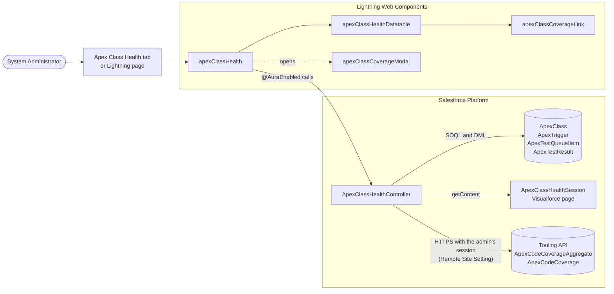
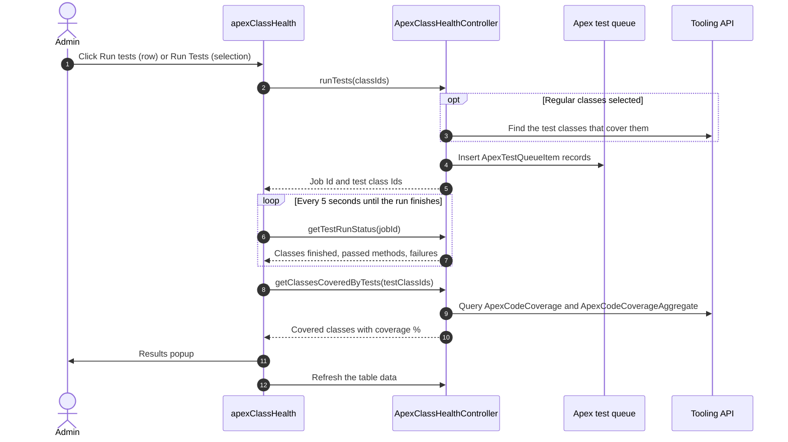

<div align="center">

# Apex Class Health

**Grade every Apex class in your org on code coverage, API version and size, then run tests and trace coverage without leaving Lightning Experience.**


</div>

> [!IMPORTANT]
> Apex Class Health is an internal, **admin-only** tool. It runs in system mode and calls the Tooling API with the signed-in administrator's session, so only System Administrators should use it.

## Contents

- [Overview](#overview)
- [Features](#features)
- [Quality grades](#quality-grades)
- [Architecture](#architecture)
- [Components](#components)
- [Apex API](#apex-api)
- [Prerequisites](#prerequisites)
- [Deployment](#deployment)
- [Using the dashboard](#using-the-dashboard)
- [Testing](#testing)
- [Security and design decisions](#security-and-design-decisions)
- [Limitations](#limitations)
- [Troubleshooting](#troubleshooting)

---

## Overview

Apex Class Health is a Lightning Web Component dashboard that lists every unmanaged Apex class in the org with a quality grade, code coverage, size and ownership details. Administrators can search, filter, sort and export the list, run tests for one or many classes, and see exactly which tests cover which classes.

| Aspect | Details |
| --- | --- |
| **What** | Dashboard of every unmanaged Apex class with grades, coverage and size metrics |
| **Who** | System Administrators |
| **Where** | **Apex Class Health** tab, or any Lightning App Page or Home Page |
| **Data** | Apex classes and triggers (SOQL), test runs (SOQL and DML), code coverage (Tooling API) |
| **Actions** | Search, filter, sort, paginate, export to CSV, run tests, inspect coverage |

---

## Features

### Inventory and grading

- Lists every unmanaged Apex class. Managed-package classes are excluded because their source and coverage aren't available.
- Gives each class a quality grade from **A** to **D**, with a **Findings** column that explains the grade.
- Shows code coverage, lines of code, characters (excluding comments), API version, type (class or test class), last modified by and last modified date.
- Class names link to the class in Setup and open in a new browser tab.

### Summary tiles

| Tile | What it shows |
| --- | --- |
| **Classes** | Number of unmanaged Apex classes |
| **Class Coverage** | Covered lines ÷ executable lines across all non-test classes that have coverage data |
| **Lines of Code** | Total lines in all classes, including comments, blank lines and test classes |
| **Apex Characters Used** | The same figure Setup shows on the Apex Classes page: classes and triggers, excluding comments and `@isTest` classes |
| **Grades** | Number of classes at each grade |

### Finding classes

- **Search** by class name or by the name of the person who last modified it. The search waits 300 ms after the last keystroke.
- **Filters:** Grade, Type (classes or test classes) and Coverage (75% or more, below 75%, no coverage data). **Clear Filters** resets them all.
- **Sorting** on any column. Empty values always sort last.
- **Pagination** with 10, 25, 50 or 100 rows per page and first, previous, next and last page buttons.
- **Export CSV** downloads the filtered and sorted list across all pages. Cells that a spreadsheet would treat as a formula are neutralised.
- **Refresh** reloads the data, which is otherwise cached in the browser.

### Running tests

- Every row has a **Run tests** (play) button. You can also tick several rows and click **Run Tests (n)** in the header.
- For a **test class**, the tool runs that class. For a **regular class**, it runs the test classes that already cover it.
- A progress bar shows how many test classes have finished. Status is checked every 5 seconds.
- When the run finishes, a popup shows:
  - the number of test methods that passed and failed
  - each failure with its class, method and error message
  - every class the run covered, with its coverage percentage and lines covered
- **View results** reopens the popup later, and the table refreshes so coverage and grades reflect the new run.

### Coverage drill-down

| Click | Popup shows |
| --- | --- |
| A class's **coverage percentage** | The test classes that cover the class, and how much of it each one covers |
| **Covered classes** on a test class | Every class the test class covers, with each class's overall coverage |

### Built-in experience

- Loading spinner, empty state, error message and a notice when coverage can't be loaded.
- Responsive layout for desktop and tablet widths.
- Labelled inputs, alternative text on icon buttons, live regions that announce result counts and test progress, and keyboard-reachable actions.

---

## Quality grades

The **base grade** comes from code coverage:

| Grade | Code coverage |
| :---: | --- |
| **A** | 90% or more |
| **B** | 75% to below 90% |
| **C** | 50% to below 75% |
| **D** | Below 50%, or no coverage data |

The grade then **drops one level** for each of these conditions, but never below **D**:

| Condition | Effect |
| --- | --- |
| API version is more than 9 releases (about 3 years) behind the newest class in the org | Drops one grade |
| Class has more than 1,000 lines | Drops one grade |

> [!NOTE]
> Test classes have no coverage of their own, so they're graded on API version and size only. The same applies to every class when coverage data can't be loaded.

**Example:** a class with 95% coverage, API version 50.0 (newest class 66.0) and 1,500 lines starts at **A**, drops to **B** for its API version, and ends at **C** for its size.

**Findings** use these values, separated by semicolons:

- `No coverage data`
- `Coverage below 50%`, `Coverage below 75%` or `Coverage below 90%`
- `API version more than 3 years old`
- `More than 1000 lines`

---

## Architecture



### Component tree

```text
apexClassHealth                     Main dashboard (tab, App Page, Home Page)
├── apexClassHealthDatatable        lightning-datatable with custom cell types
│   ├── gradeBadge.html             Grade badge cell
│   └── coverageLink.html           Coverage cell
│       └── apexClassCoverageLink   Clickable coverage % or "Covered classes" link
└── apexClassCoverageModal          Popup (LightningModal), opened on demand
```

### Test run flow



---

## Components

| # | Type | API name | Purpose |
| :---: | --- | --- | --- |
| 1 | Visualforce Page | `ApexClassHealthSession` | Renders the administrator's API-enabled session so the controller can call the Tooling API |
| 2 | Apex Class | `ApexClassHealthController` | Loads classes, grades, coverage and trigger characters; runs tests; returns coverage breakdowns |
| 3 | Apex Class (test) | `ApexClassHealthControllerTest` | Unit tests for the controller, required for production deployments |
| 4 | Lightning Web Component | `apexClassCoverageLink` | Clickable coverage percentage or **Covered classes** link inside a table cell |
| 5 | Lightning Web Component | `apexClassHealthDatatable` | Extends `lightning-datatable` with the grade badge and coverage link cell types |
| 6 | Lightning Web Component | `apexClassCoverageModal` | Popup with test results and coverage breakdowns |
| 7 | Lightning Web Component | `apexClassHealth` | Main dashboard: tiles, search, filters, sorting, pagination, export and test runs |
| 8 | Custom Tab | `Apex_Class_Health` | Opens the dashboard from the App Launcher |

<details>
<summary><strong>Source file inventory</strong></summary>

```text
force-app/main/default/
├── pages/
│   ├── ApexClassHealthSession.page
│   └── ApexClassHealthSession.page-meta.xml
├── classes/
│   ├── ApexClassHealthController.cls
│   ├── ApexClassHealthController.cls-meta.xml
│   ├── ApexClassHealthControllerTest.cls
│   └── ApexClassHealthControllerTest.cls-meta.xml
├── lwc/
│   ├── apexClassHealth/
│   │   ├── apexClassHealth.html
│   │   ├── apexClassHealth.js
│   │   ├── apexClassHealth.css
│   │   ├── apexClassHealth.js-meta.xml
│   │   └── __tests__/
│   │       └── apexClassHealth.test.js       Jest tests (local only, never deployed)
│   ├── apexClassHealthDatatable/
│   │   ├── apexClassHealthDatatable.js
│   │   ├── apexClassHealthDatatable.js-meta.xml
│   │   ├── gradeBadge.html
│   │   └── coverageLink.html
│   ├── apexClassCoverageLink/
│   │   ├── apexClassCoverageLink.html
│   │   ├── apexClassCoverageLink.js
│   │   └── apexClassCoverageLink.js-meta.xml
│   └── apexClassCoverageModal/
│       ├── apexClassCoverageModal.html
│       ├── apexClassCoverageModal.js
│       └── apexClassCoverageModal.js-meta.xml
└── tabs/
    └── Apex_Class_Health.tab-meta.xml
```

</details>

---

## Apex API

All methods are `@AuraEnabled` on `ApexClassHealthController`.

| Method | Cacheable | Parameters | Returns | Purpose |
| --- | :---: | --- | --- | --- |
| `getApexClassHealth()` | Yes | None | `HealthReport` | Every unmanaged class with metrics, grade and findings, plus trigger characters and any coverage notice |
| `runTests(classIds)` | No | `List<Id>` | `TestRun` | Queues the selected test classes, plus the test classes that cover any selected regular class |
| `getTestRunStatus(jobId)` | No | `Id` | `TestRunStatus` | Progress of a run; passed methods and failures once it finishes |
| `getClassesCoveredByTests(testClassIds)` | No | `List<Id>` | `List<CoverageItem>` | Classes and triggers the tests exercise, with each one's overall coverage |
| `getTestsCoveringClass(classId)` | No | `Id` | `List<CoverageItem>` | Test classes that cover a class, with the share of its lines each one covers |

<details>
<summary><strong>Response types</strong></summary>

| Type | Fields |
| --- | --- |
| `HealthReport` | `classes`, `coverageAvailable`, `coverageMessage`, `triggerCharacters` |
| `ClassHealth` | `id`, `name`, `isTest`, `apiVersion`, `linesOfCode`, `characters`, `linesCovered`, `linesUncovered`, `coverage`, `grade`, `findings`, `lastModifiedDate`, `lastModifiedBy` |
| `TestRun` | `jobId`, `testClassIds`, `classesWithoutTests` |
| `TestRunStatus` | `isComplete`, `classesTotal`, `classesCompleted`, `methodsPassed`, `failures` |
| `TestFailure` | `className`, `methodName`, `message` |
| `CoverageItem` | `id`, `name`, `linesCovered`, `linesTotal`, `coverage` |

</details>

### Data sources

| Source | Object | Used for |
| --- | --- | --- |
| SOQL | `ApexClass` | Class list, size and test-class detection. Class bodies never leave the server. |
| SOQL | `ApexTrigger` | Trigger characters for the **Apex Characters Used** tile |
| SOQL and DML | `ApexTestQueueItem` | Queuing test runs and tracking their progress |
| SOQL | `ApexTestResult` | Passed and failed test methods, with failure messages |
| Tooling API | `ApexCodeCoverageAggregate` | Overall coverage per class |
| Tooling API | `ApexCodeCoverage` | Per-test coverage for the popups and for finding a class's tests |

---

## Prerequisites

| Requirement | Why | How |
| --- | --- | --- |
| **System Administrator profile** | Reading Apex metadata, running tests and calling the Tooling API need Author Apex, Customize Application and API access | Give every user of the tool the System Administrator profile |
| **Remote Site Setting** for your My Domain URL | Lets Apex call the org's own Tooling API | Setup → **Remote Site Settings** → **New**. Use the URL from Setup → **My Domain** → *Current My Domain URL* |
| **Per-test coverage storage** | The coverage popups read coverage per test | Setup → **Apex Test Execution** → **Options** → untick **Store Only Aggregated Code Coverage** |

> [!TIP]
> Each sandbox has its own My Domain URL. Add a Remote Site Setting in every sandbox, and again after each refresh.

---

## Deployment

Deploy the components in this order. Each one depends on the ones above it.

| Step | Metadata type | Name |
| :---: | --- | --- |
| 1 | ApexPage | `ApexClassHealthSession` |
| 2 | ApexClass | `ApexClassHealthController` |
| 3 | ApexClass | `ApexClassHealthControllerTest` |
| 4 | LightningComponentBundle | `apexClassCoverageLink` |
| 5 | LightningComponentBundle | `apexClassHealthDatatable` |
| 6 | LightningComponentBundle | `apexClassCoverageModal` |
| 7 | LightningComponentBundle | `apexClassHealth` |
| 8 | CustomTab | `Apex_Class_Health` |

> [!NOTE]
> Deploying everything in a single command lets Salesforce resolve the order automatically. The order only matters when you deploy one component at a time, for example with a change set.

**Salesforce CLI (PowerShell):**

```powershell
sf project deploy start `
  --metadata ApexPage:ApexClassHealthSession `
  --metadata ApexClass:ApexClassHealthController `
  --metadata ApexClass:ApexClassHealthControllerTest `
  --metadata LightningComponentBundle:apexClassCoverageLink `
  --metadata LightningComponentBundle:apexClassHealthDatatable `
  --metadata LightningComponentBundle:apexClassCoverageModal `
  --metadata LightningComponentBundle:apexClassHealth `
  --metadata CustomTab:Apex_Class_Health `
  --target-org <org-alias>
```

For a production org, add `--test-level RunSpecifiedTests --tests ApexClassHealthControllerTest`.

**After deploying:**

1. Complete the [prerequisites](#prerequisites).
2. Open the App Launcher and search for **Apex Class Health**.
3. If the tab doesn't appear, set it to **Default On** in the System Administrator profile's tab settings, or add it to your app's navigation.
4. To place the dashboard on another page, drag **Apex Class Health** onto any App Page or Home Page in Lightning App Builder.

---

## Using the dashboard

### Review class health

1. Check the summary tiles for overall coverage, size and the grade distribution.
2. Filter by **Grade D** or **Below 75%** coverage to find the classes that need attention first.
3. Read the **Findings** column to see why a class has its grade.

### Run tests

1. Click the play button on a row, or tick several rows and click **Run Tests (n)**.
2. Watch the progress bar until every test class has finished.
3. Review the results popup for failures and the coverage of every class the run touched.
4. Click **View results** to reopen the popup later.

### Inspect coverage

- Click a coverage percentage to see which test classes cover that class.
- Click **Covered classes** on a test class to see what it covers.

### Export

Click **Export CSV** to download the current filtered and sorted list. The file includes lines covered and uncovered, which aren't shown in the table.

---

## Testing

### Apex

```powershell
sf apex run test --class-names ApexClassHealthControllerTest --code-coverage --result-format human --wait 10 --target-org <org-alias>
```

`ApexClassHealthControllerTest` mocks every Tooling API callout and covers:

- class metrics, grades and Tooling API paging
- missing coverage data and failed Tooling API calls
- the full grading rubric, including findings
- finding test classes for regular classes, and selected test classes needing no lookup
- the error when no tests cover the selection
- test run status, classes covered by tests, and merged per-method coverage

> [!NOTE]
> Apex tests can't queue other tests or render Visualforce pages. The lines that insert `ApexTestQueueItem` records and read the session from `ApexClassHealthSession` are therefore checked manually: run a test class from the dashboard and confirm the results popup appears.

### Lightning Web Components (Jest)

```powershell
npm install
npm run test:unit -- apexClassHealth
```

The Jest suite covers rendering and pagination, debounced search, grade filtering, sorting, the coverage notice, error handling, Setup-aligned character totals, running selected tests, the results popup after a run, and the coverage popup.

---

## Security and design decisions

| Decision | Reason |
| --- | --- |
| `without sharing` and `WITH SYSTEM_MODE` | Every administrator sees every class. Only metrics are returned to the browser, never source code. |
| API session from a Visualforce page | Lightning sessions can't call the REST API. The session stays on the server, and each callout runs as the administrator using the dashboard. |
| Typed Ids in Tooling API queries | Queries are built only from `Id` values, which can't carry SOQL injection. |
| CSV export sanitising | Cells starting with `=`, `+`, `-` or `@` are prefixed so spreadsheets don't run them as formulas. |
| Callout limit guard | Tooling API paging stops before the callout limit, so the class list always loads. |
| Chunked SOQL loop | Class bodies are processed 200 at a time to stay within heap limits. |

> [!CAUTION]
> Salesforce discourages passing session IDs this way, and the pattern wouldn't pass AppExchange security review. It's acceptable here because the tool is internal and admin-only. If non-administrators ever need access, switch the controller to a Named Credential.

---

## Limitations

- Test classes are detected by `@isTest` appearing anywhere in the class body. A regular class that mentions `@isTest` in a comment is treated as a test class.
- Classes without executable lines, such as interfaces, have no coverage data and are graded **D** when coverage is available.
- Coverage reflects the most recent run of each test. Run tests to update it.
- **Class Coverage** covers classes only, while Setup's org-wide estimate also includes triggers.
- Running tests for a regular class only works if per-test coverage already links it to its tests.
- Only one test run at a time per open dashboard. Asynchronous test runs count toward the daily limit: the greater of 500 or 10 × the number of test classes per 24 hours (20 × in sandboxes).

---

## Troubleshooting

| Symptom | Likely cause | Fix |
| --- | --- | --- |
| Notice: *Code coverage is unavailable (Unauthorized endpoint …)* | Remote Site Setting is missing | Add your My Domain URL in Remote Site Settings |
| Notice mentions *401* or *INVALID_SESSION_ID* | `ApexClassHealthSession` isn't deployed, or the user isn't a System Administrator | Deploy the Visualforce page and use an administrator |
| Notice: *No code coverage data was found* | Tests haven't run, or coverage was cleared | Run all tests from Setup → Apex Test Execution |
| Coverage popups are empty | Per-test coverage isn't stored, or tests haven't run since it was enabled | Untick **Store Only Aggregated Code Coverage**, then run the tests |
| *No tests found for the selected classes* | No coverage data links a test to the selected class | Select the test classes directly, or run all tests once |
| *Tests are already running* | A run is still in progress on this dashboard | Wait for it to finish |
| **Apex Characters Used** differs slightly from Setup | A regular class mentions `@isTest` in a comment | Expected; remove the comment if an exact match matters |
| Tab missing from the App Launcher | Tab is hidden on the profile | Set the tab to **Default On** for System Administrator, or add it to an app |

---

<div align="center">

Made with ❤️ by **Sagar Choudhary**

</div>
